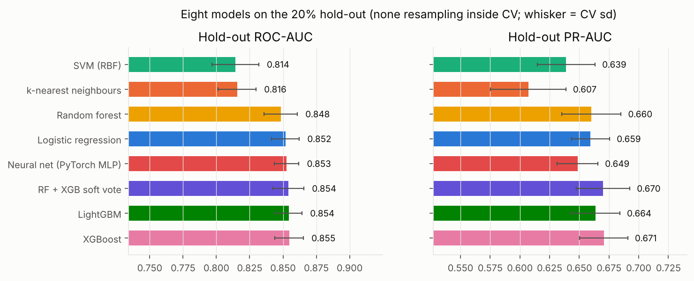
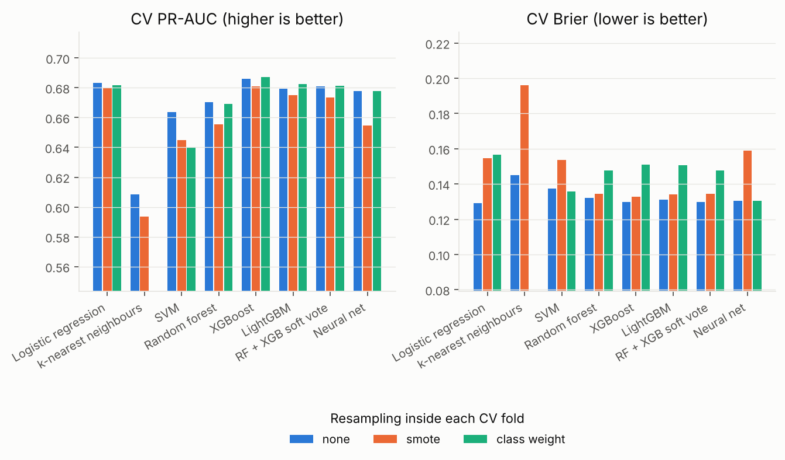
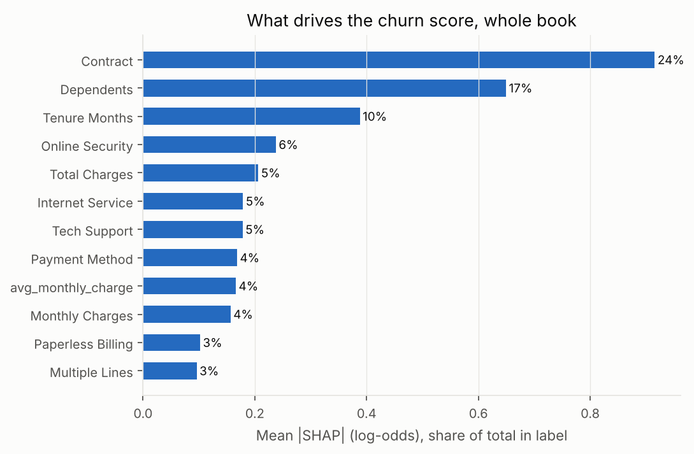
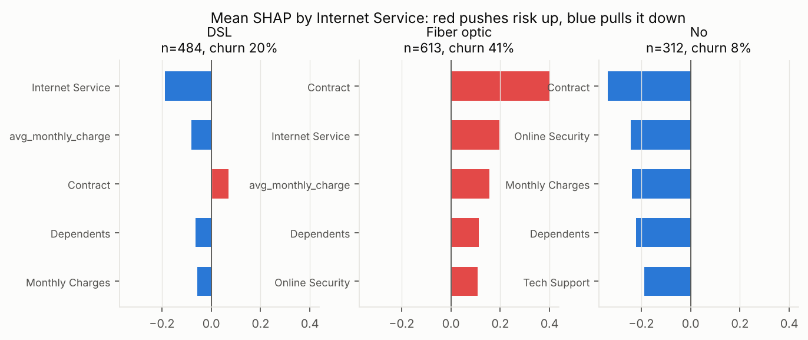
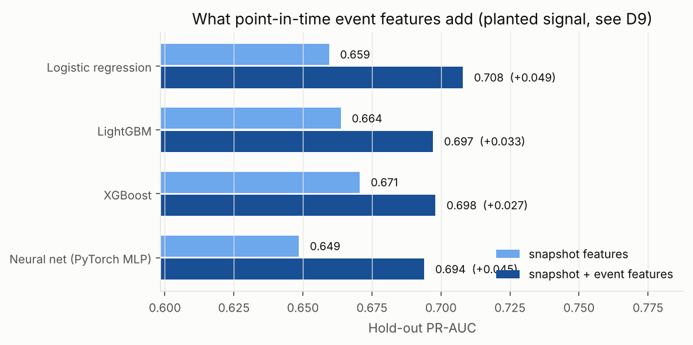
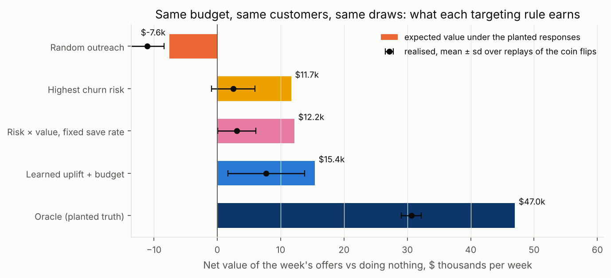
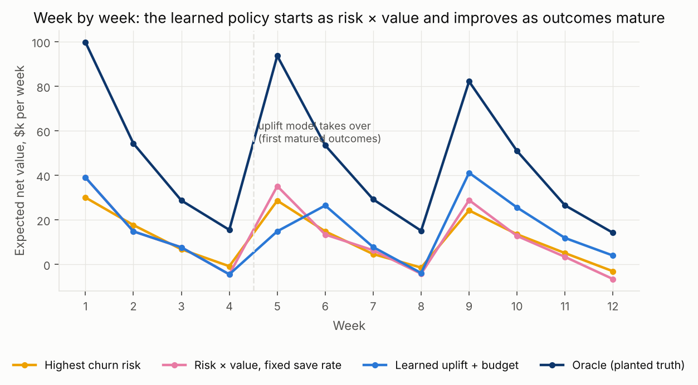
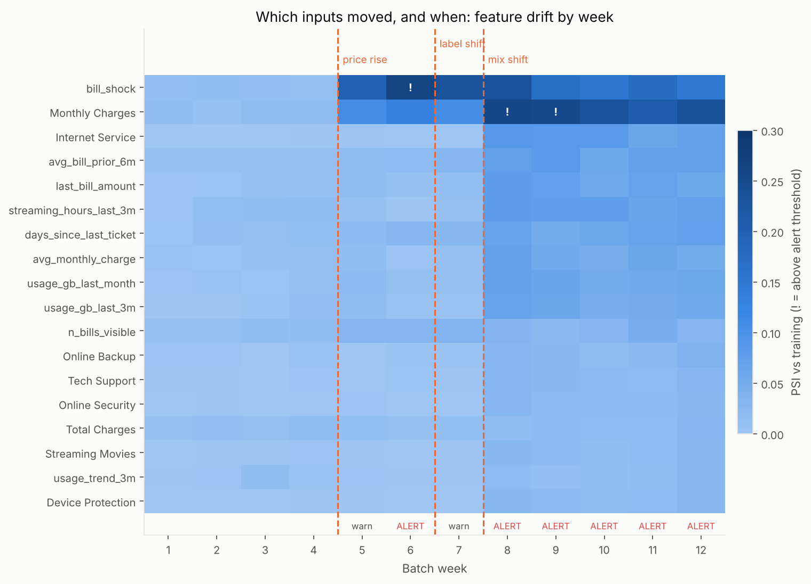
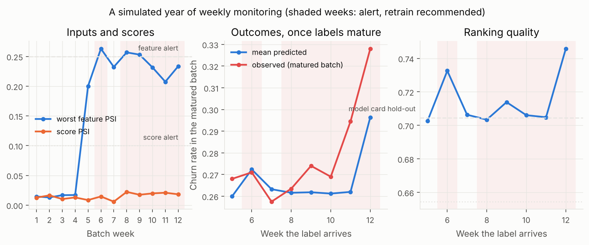

# Retention propensity and offer targeting on the Telco churn data

**Who is about to leave, what is each of them worth, and which ones should a fixed
weekly retention budget reach?**

An end-to-end retention-analytics project on the IBM Telco customer churn data
(7,043 real subscribers, 26.5% churn). It benchmarks eight churn-propensity models
the honest way (resampling inside cross-validation, one untouched hold-out,
calibration reported next to discrimination), explains the scores with SHAP at
three altitudes (book, segment, customer), and is being extended, phase by phase,
into the thing a retention team actually runs: event-level features built in SQL
as of a date, a weekly multi-offer targeting loop under a budget with a randomised
exploration holdout, a model registry, drift monitoring, an Airflow DAG, and a
Streamlit app for the people who own the offers.

> **Status: phases 1 to 4 of 5 are complete** (honest benchmark, feature
> selection, SHAP, tests, CI; a synthetic event log with point-in-time SQL
> features; a simulated three-offer weekly loop with a randomised holdout, budgeted
> uplift targeting and off-policy evaluation; MLflow registry with a gated,
> committed production export, drift monitoring on a simulated year of batches, an
> Airflow DAG validated in CI and a weekly GitHub Actions job). The build order and what each phase adds is in [Phases](#phases). The
> 2023 version of this repository (one notebook and a Streamlit script that
> retrained models on every click) is kept in `legacy/`.
>
> **What is real and what is simulated.** The 7,043 customers, their contracts,
> services, charges and churn labels are real (IBM's sample data). The monthly
> bills, payments, usage, tickets and plan changes behind each customer are
> **synthetic**, generated to be consistent with each real row, with a small churn
> signal planted and calibrated (D9). How customers respond to the three offers in
> phase 3 is synthetic too, planted from readable rules (D12). Every number below
> says which it is.

This is the operations-side companion to
[revenue-tier-and-churn-experiment](https://github.com/hrootscraft/revenue-tier-and-churn-experiment)
(tierlift), which covers experiment design, CUPED, uplift-learner benchmarking and
effect durability on simulated data. The split is deliberate:
[`docs/learn/03_propensity_vs_uplift.md`](docs/learn/03_propensity_vs_uplift.md).

## Headline results (`results/headline_phase{1,2,3,4}.json`)

| Question | Method | Result |
|---|---|---|
| How well can churn be ranked? | 8 models, 2 × 5-fold stratified CV on 80%, scored once on the 20% hold-out | **XGBoost ROC-AUC 0.855, PR-AUC 0.671**; six of eight models within 0.007 ROC-AUC of each other (`results/benchmark_test.csv`) |
| What does the top decile buy? | Lift @ top decile; recall @ precision ≥ 0.5 | **2.9× lift**: the riskiest 10% churn at 78% vs 26.5% base; **87% of churners** are caught at 50% precision |
| Does SMOTE help under 26.5% imbalance? | Same folds, three regimes: none / SMOTE / class weights | **No.** SMOTE lowers CV PR-AUC for every model and raises Brier by 3–35%; the shipped model uses no resampling (D3) |
| Can the probabilities be multiplied by dollars? | Brier, ECE, reliability curve | **ECE 0.022** for XGBoost with no post-hoc calibration; the curve sits on the diagonal (figure 05) |
| What about "87% accuracy"? | Accuracy @ 0.5 next to "nobody churns" | **80.3%** vs **73.5%** for predicting nobody churns. Accuracy is reported, not trusted (D4) |
| Does backward stepwise help? | Logistic LR-test by feature block; L1; permutation importance | Keeps **12 of 22** features at ROC-AUC **0.861 vs 0.860**: a parsimony tool, not a performance lever (D5) |
| What drives the score? | SHAP on LightGBM, one-hot columns folded back | **Contract 24%** of total attention, Dependents 17%, Tenure 10%. Month-to-month contracts churn at **42.7%** vs 2.8% on two-year (not the 75% vs 3% in older write-ups) |
| What do event-level features add, computed as of a date? | 461k synthetic events → 22 features in DuckDB SQL with an `{as_of}` filter; same split and folds | **+0.03 to +0.05 PR-AUC** on the hold-out for all four models (XGBoost 0.671 → 0.698, logistic 0.659 → 0.708); event features take 29% of SHAP attention, led by the 3-month usage trend. Lift is from a *planted* signal calibrated to be modest (D9) |
| Does anything read the future? | Point-in-time test: edit every event after the as-of date, rebuild | **Feature table unchanged, byte for byte** (`tests/test_events.py::test_point_in_time`) |
| Which offer, for whom, under a budget? | 12-week simulated loop, 8% randomised holdout, six policies on common random numbers | Learned uplift + Lagrangian allocation earns **$14.4k/week vs $6.8k** for risk × value over the second half, with 19% fewer offers and half the sleeping-dog share; oracle ceiling $47.0k/week. Responses are *planted* (D12) |
| Which model is live, and should the new one replace it? | MLflow registry + gate + committed export | **v1 in production** (PR-AUC 0.704); a candidate without event features is **refused by the gate** (0.671) |
| Does the model still fit this week's customers? | PSI/KS, score and matured-outcome monitors on 12 weekly batches with injected drift | Price rise **warns at week 5**, mix shift **alerts at week 8**, concept drift surfaces **at week 11** through outcomes (observed churn 0.294 vs 0.262, z = 3.3); score PSI never exceeds 0.02 |
| Can the holdout prove it? | IPS / doubly robust OPE on the exploration rows, with power | **Not at 12 weeks**: DR interval ±$309.3k/week around a true $17.2k; ~5,928 weeks to detect (D18, figure 16) |

<p align="center"></p>

## Contents

1. [The business problem](#1-the-business-problem)
2. [The data, and the leakage trap in it](#2-the-data-and-the-leakage-trap-in-it)
3. [Phase 1 results](#3-phase-1-results)
4. [Phase 2: event-level features in SQL, as of a date](#4-phase-2-event-level-features-in-sql-as-of-a-date)
5. [Phase 3: three offers, a weekly loop, uplift under a budget](#5-phase-3-three-offers-a-weekly-loop-uplift-under-a-budget)
6. [Phase 4: owning the model in production](#6-phase-4-owning-the-model-in-production)
7. [What I would tell marketing](#7-what-i-would-tell-marketing)
8. [Phases](#phases)
9. [How to run it](#9-how-to-run-it)
10. [Repository layout](#10-repository-layout)
11. [Learning write-ups](#11-learning-write-ups)
12. [Limitations](#12-limitations)

## 1. The business problem

A telco loses about a quarter of its customers a year. Winning a new one costs
several times what keeping an existing one costs, so every quarter marketing has a
retention budget and a question: *who gets an offer?*

The naive answer, "whoever is most likely to leave", is wrong in two ways. A churn
score cannot tell a customer an offer would save from one who is leaving regardless,
and it cannot see the customer who was staying until the offer reminded them to
shop around. A churn score is still the right *first* model: it is what the data
can support today, its probabilities set the stakes for each customer, and its
drivers tell you where the levers might be. This repository builds that model
honestly in phase 1 and then, in phases 2–5, builds the loop that turns it into
offers, measures them, and keeps the model alive in production.

## 2. The data, and the leakage trap in it

`data/raw/Telco_customer.xlsx` is IBM's 33-column sample dataset ("Telco customer
churn", shipped with IBM Cognos Analytics). It has the same 7,043 customers as the
21-column Kaggle version, plus California geography and four columns recorded
*after* the customer churned:

| Column | What it is | Used as a feature? |
|---|---|---|
| `Churn Label` / `Churn Value` | The target | target only |
| `Churn Score` | IBM's own model score | **never** |
| `Churn Reason` | Exit-survey answer, only for churners | **never** |
| `CLTV` | IBM's lifetime-value estimate | **never as a feature**; used in the decision layer (phase 3) to price a customer |

`churnprop.data.assert_no_leakage` raises before any model sees a matrix containing
these. Keeping them in the file and refusing them in code is the point (D1).

Features: 19 raw columns (demographics, services, contract, billing) plus three
engineered ones (`n_addon_services`, `avg_monthly_charge`, `tenure_band`). One
`ColumnTransformer` (scale numerics, one-hot categoricals) is the first step of
every model's pipeline, so it is fitted inside each CV fold.

## 3. Phase 1 results

### 3.1 Eight models, one protocol

80/20 stratified split; 2 × 5-fold stratified CV on the 80% for every choice; the
20% scored once. Models: logistic regression, k-NN, SVM (RBF, Platt-scaled),
random forest, XGBoost, LightGBM, an RF + XGBoost soft-vote ensemble, and a PyTorch
MLP (64-32, dropout, early stopping) wrapped as a scikit-learn estimator so it runs
through the identical pipeline (D6).

| Model | ROC-AUC | PR-AUC | Lift @ top 10% | Recall @ P ≥ 0.5 | Accuracy | Brier | ECE |
|---|---|---|---|---|---|---|---|
| **XGBoost** | **0.855** | **0.671** | 2.94 | 0.869 | 0.803 | 0.133 | 0.022 |
| LightGBM | 0.854 | 0.664 | **2.99** | **0.874** | 0.802 | 0.133 | 0.029 |
| RF + XGB soft vote | 0.854 | 0.670 | 2.91 | 0.872 | **0.807** | **0.132** | 0.018 |
| Neural net (PyTorch MLP) | 0.853 | 0.649 | 2.75 | 0.834 | 0.801 | 0.134 | **0.017** |
| Logistic regression | 0.852 | 0.659 | 2.83 | 0.826 | 0.804 | 0.134 | 0.026 |
| Random forest | 0.848 | 0.660 | 2.89 | 0.850 | 0.806 | 0.134 | 0.023 |
| k-nearest neighbours | 0.816 | 0.607 | 2.65 | 0.754 | 0.776 | 0.149 | 0.050 |
| SVM (RBF) | 0.814 | 0.639 | 2.89 | 0.799 | 0.803 | 0.142 | 0.028 |
| *Predict nobody churns* | *0.500* | *0.265* | *1.00* | *0* | *0.735* | | |

Hold-out, no resampling. CV standard deviations are ±0.01 ROC-AUC and ±0.02 PR-AUC
(`results/benchmark_cv.csv`), so the top six are statistically a tie: on 5,600
training rows with 22 tabular features, gradient boosting, a linear model and a
small neural net all find the same signal. The choice between them is made on
calibration, speed and explainability, which is why LightGBM carries the SHAP work
and XGBoost is the reference ranker.

### 3.2 SMOTE, compared rather than assumed

<p align="center"></p>

SMOTE is applied inside each fold through `imblearn.Pipeline`, so synthetic rows are
built from training rows only. Done that way, it does not help here: for all eight
models CV PR-AUC is equal or lower and Brier is worse, because oversampling to 50/50
shifts the predicted probabilities toward 0.5. Class weights behave like a milder
SMOTE. The models that ship use no resampling and are well calibrated as a result
(figure 05). Why this is the expected outcome, with worked examples:
[`docs/learn/01_imbalance_and_metrics.md`](docs/learn/01_imbalance_and_metrics.md).

### 3.3 Feature selection: stepwise, L1, permutation

Backward stepwise done as a logistic likelihood-ratio test on whole feature blocks
(D5) removes 10 of 22 features (gender, phone service, device protection, online
backup, senior citizen, total charges, average monthly charge, tech support, online
security, add-on count). Logistic CV ROC-AUC moves from 0.8601 to 0.8608. L1 keeps
19; permutation importance on LightGBM agrees on the top three (Contract,
Dependents, Tenure). `results/feature_selection.csv`, figure 07.

### 3.4 What drives the score

<p align="center"></p>

Folding one-hot columns back to their feature, Contract carries 24% of the model's
total |SHAP|, Dependents 17%, Tenure 10%. Within segments the picture changes, which
is the altitude an offer owner works at:

<p align="center"></p>

For fibre customers (41% churn), being on a month-to-month contract, the fibre
price itself and missing online security push risk up; for DSL customers nearly
everything pulls it down. `results/shap_by_segment.csv`, figures 08–09, and
[`docs/learn/02_shap_three_altitudes.md`](docs/learn/02_shap_three_altitudes.md).

## 4. Phase 2: event-level features in SQL, as of a date

The snapshot has no time in it beyond tenure. Real retention models are built from
event tables (bills, payments, tickets, usage) and the hard part of building them is
not the SQL, it is making sure every feature is computed **as of the scoring date**
so that nothing from the customer's future leaks into their training row.

**The event log (synthetic).** `churnprop events` generates, behind each real
customer, one bill per month of tenure ending at a snapshot date of 2024-06-30
(summing to the real `Total Charges`), a payment with lateness driven by the real
payment method, monthly usage for internet customers, support tickets whose rate
follows the real services (fibre without tech support raises more), and occasional
plan changes; non-churners get three more months past the snapshot so the
point-in-time rule has something to catch. 461k rows, 10 MB of zstd Parquet
partitioned by month (`data/events/`, regenerable, not committed). A churn signal is
planted in the last three months (more late payments and tickets, falling usage,
downgrades) at `events.signal: 0.15`, calibrated so the features add about 0.03
PR-AUC (D9).

**The features (SQL).** Four files in `sql/`, one per family, each with a single
parameter `{as_of}`; the first CTE filters the source table to events on or before
that date and every window and aggregate runs on the filtered set. DuckDB runs them
straight off the Parquet partitions in 0.5 s; `--engine spark` runs the identical
SQL through PySpark. 22 features: bill shock (last bill vs the prior 6-month
average), late payments and late days in 90 days, late rate in a year, late streak,
usage level and 3-month trend, tickets in 90 and 365 days, network tickets, days
since last ticket, CSAT and resolution time, days since last plan change,
downgrades and upgrades in 180 days.

**The test.** `test_point_in_time` builds the table as of a date 45 days before the
snapshot, then multiplies every later bill by 10, marks it late, zeroes later usage,
injects 400 later tickets and downgrades, rebuilds, and asserts equality. A leak in
any feature fails with its column name.

<p align="center"></p>

| Model | PR-AUC, snapshot | PR-AUC, + events | ROC-AUC, snapshot | ROC-AUC, + events | Lift @ top 10%, + events |
|---|---|---|---|---|---|
| Logistic regression | 0.659 | **0.708** | 0.852 | 0.871 | 3.05 |
| LightGBM | 0.664 | 0.697 | 0.854 | 0.869 | 3.10 |
| XGBoost | 0.671 | 0.698 | 0.855 | 0.872 | 3.05 |
| Neural net | 0.649 | 0.694 | 0.853 | 0.869 | 3.07 |

Hold-out, same split and folds as phase 1. The gain is largest for the linear model,
which could not build "trend" or "streak" from the snapshot and now gets them
pre-computed; the boosters already squeezed more from tenure and charges. Event
features take 29% of SHAP attention (figure 11), led by the usage trend, usage level
and late days, which is where the signal was planted; nothing unplanted lit up, which
is the check that matters. Why the lift is honest only as a statement about the
pipeline, and what a real lift would need:
[`docs/learn/04_point_in_time_features.md`](docs/learn/04_point_in_time_features.md).

## 5. Phase 3: three offers, a weekly loop, uplift under a budget

Phases 1–2 say *who* is likely to leave. A retention programme has to decide *who
gets which offer this week* with a fixed budget, learn from what happened, and be
able to prove afterwards that it worked. The IBM file has no treatment in it, so
phase 3 **simulates how the real customers respond** to three offers (a $45 bill
credit, a $60 tech-support bundle, a $70 contract-upgrade incentive) and runs the
weekly loop a team would run. Everything about the responses is invented and
written as readable rules in [`configs/offers.yaml`](configs/offers.yaml), including
**sleeping dogs**: new customers who read a credit as bait-and-switch, two-year
customers whom any contact reminds to shop (D12).

**The loop** (`churnprop loop`, 12 weeks, `src/churnprop/loop.py`). Each week, the
active book is scored; 8% of eligible customers go to a **randomised exploration
holdout** (uniform over control and the three offers, probability logged); the
policy spends the rest of a $32,000 budget; outcomes (churn within 4 weeks) mature
four weeks later and are appended to the training log; a customer who got an arm is
on cooldown for 4 weeks. Six policies run on **identical customers, budget and coin
flips**, so the differences are the targeting rule's:

| Policy | Expected net value, $/week (planted truth) | …second half of the horizon | Customers retained vs no offers (mean ± sd, 5 replays) | Share of offers sent to sleeping dogs | Offers sent |
|---|---|---|---|---|---|
| Random outreach (bill credit) | $-7.6k | $-9.3k | +21 ± 7 | 30% | 4,984 |
| Highest churn risk (bill credit) | $11.7k | $7.2k | +57 ± 9 | 19% | 4,897 |
| Risk × CLTV × assumed save rate − cost | $12.2k | $6.8k | +56 ± 9 | 18% | 4,891 |
| **Learned multi-offer uplift + budget allocator** | $15.4k | $14.4k | +69 ± 17 | 15% | 3,961 |
| Oracle: planted truth, same allocator | $47.0k | $36.4k | +131 ± 5 | 0% | 3,708 |

<p align="center"></p>

How to read it. **Risk-ranked targeting earns money** ($11.7k a week on a ~5,000
customer book) but one offer in five goes to a customer the offer pushes out, because
"likely to churn" and "will respond to this offer" are different lists
([learn note 03](docs/learn/03_propensity_vs_uplift.md)). The **uplift policy starts
as the risk × value heuristic**, fits a T-learner (one LightGBM per arm, D17) in week
5 when the first outcomes mature, and from then on chooses *which* offer and *whether
to offer at all*: over the second half it earns **$14.4k a week against
$6.8k** for the heuristic, sends 19% fewer offers, and halves the
sleeping-dog share. It still captures only a third of the oracle, which knows every
customer's true response: twelve weeks of an 8% holdout is a small amount of causal
data, and the learning curve (figure 13) is still rising at week 12.

**Budget allocation** (`uplift/allocate.py`). "One arm per customer, total cost ≤
budget" is solved with a single Lagrange multiplier λ: every offer must clear
`uplift × CLTV − cost − λ · cost > 0`, and bisection on λ hits the budget. The
allocator is within 0.0% of the LP relaxation's bound (`lp_gap` in
`headline_phase3.json`) and λ is a number finance can read: at a $10k budget the
marginal offer returns $5.6 per $1 of cost beyond itself; at $80k, $0.37 (figure 15).

**Off-policy evaluation, and why it is reported with its standard error.** The
exploration rows let IPS and doubly robust estimators value any policy without
running it (`uplift/ope.py`). Both are unbiased, and at 12 weeks both are useless:
the reward is dollars × a rare churn event, so the DR 95% interval on the uplift
policy's value is **±$309.3k a week around a true $17.2k**; the minimum effect
this holdout could detect at 80% power is $441.8k a week, and detecting the
policy's actual value would take on the order of 5,928 weeks of logging (figure 16,
D18). That is the real finding of the phase for anyone who runs retention holdouts:
a small randomised holdout proves a programme is not harmful long before it measures
its value, which is why the simulator's planted truth is the yardstick here and why
the learner trains on every logged row rather than the holdout alone (D17). What
would fix it (a holdout concentrated where the policy acts, a churn-rate test with
dollars reported descriptively, more weeks) is worked through with numbers in
[`docs/learn/05_budget_allocation_and_ope.md`](docs/learn/05_budget_allocation_and_ope.md).

<p align="center"></p>

## 6. Phase 4: owning the model in production

Phases 1–3 produce a model and a decision rule. Owning them means being able to say,
every week, which version is live, whether this week's inputs look like the training
data, whether last month's predictions came true, and what to do when they did not.

**Registry and export (D19, D20).** `churnprop train` fits the production pipeline
(XGBoost on snapshot + event features) and logs parameters, hold-out metrics, data
hash, git commit, the pipeline and the monitoring reference statistics to **MLflow**
(tracking + Model Registry on a local SQLite file), registering the version with the
alias `candidate`. `churnprop promote` runs a **gate** (hold-out PR-AUC within 0.005
of production, ECE ≤ 0.05), moves the `production` alias and exports the version to
[`models/production/`](models/production/) as plain files, committed: `model.joblib`,
[`model_card.json`](models/production/model_card.json), `reference_stats.json`. Every
consumer (scoring, the DAG, the Actions job, the app) reads the export, so nothing
needs an MLflow server, and the git log of that folder is the deployment history.
`promote --rollback` swaps `production` and `previous`. The end-to-end run promotes
**v1 (PR-AUC 0.704, ECE 0.023)** and then trains a deliberately weaker v2
without event features, which the gate refuses (**0.671, trails by 0.034**;
`results/registry.csv`).

**Weekly batches with drift (D21).** `churnprop batches` writes twelve weekly cohorts:
2,000-row resamples of the **hold-out customers** (so later label checks are honest)
with event features computed as of each week, and three drifts injected on a schedule
in [`configs/default.yaml`](configs/default.yaml): a 12% **price rise** on fibre from
week 5 (covariate shift), an acquisition **mix shift** toward fibre from week 8
(population drift), and a **label shift** in the electronic-check month-to-month
segment from week 7 (concept drift: no feature changes, churn does).

**Monitoring (D22).** `churnprop weekly --week N` validates the batch, scores it, and
runs four checks against reference statistics captured at training time: per-feature
PSI and KS (with the reference ECDF stored at the quantile grid so discrete features
such as ticket counts do not false-alarm), score PSI and mean shift, and, once a
batch's labels mature four weeks later, observed vs predicted churn (with a z-test),
ECE and PR-AUC against the model card; plus realised-vs-predicted uplift on the
phase-3 exploration rows when the loop log is present. Reports go to
[`results/monitoring/`](results/monitoring/) as JSON and Markdown, with
`summary.csv` and `latest.md` for the issue the Actions job opens.

<p align="center"></p>

| Week | Verdict | Retrain | Worst feature PSI | Score PSI | Observed / predicted churn (latest matured batch) | Drift injected |
|---|---|---|---|---|---|---|
| 1 | ok |  | Monthly Charges 0.01 | 0.01 |  |  |
| 2 | ok |  | bill_shock 0.01 | 0.02 |  |  |
| 3 | ok |  | Tenure Months 0.02 | 0.01 |  |  |
| 4 | ok |  | Monthly Charges 0.02 | 0.01 |  |  |
| 5 | warn |  | bill_shock 0.20 | 0.01 | 0.268 / 0.260 | price rise |
| 6 | alert | yes | bill_shock 0.26 | 0.01 | 0.271 / 0.272 | price rise |
| 7 | warn |  | bill_shock 0.23 | 0.01 | 0.258 / 0.263 | label shift, price rise |
| 8 | alert | yes | Monthly Charges 0.26 | 0.02 | 0.264 / 0.262 | label shift, mix shift, price rise |
| 9 | alert | yes | Monthly Charges 0.25 | 0.02 | 0.274 / 0.262 | label shift, mix shift, price rise |
| 10 | alert | yes | Monthly Charges 0.23 | 0.02 | 0.269 / 0.261 | label shift, mix shift, price rise |
| 11 | alert | yes | Monthly Charges 0.21 | 0.02 | 0.294 / 0.262 | label shift, mix shift, price rise |
| 12 | alert | yes | Monthly Charges 0.23 | 0.02 | 0.328 / 0.296 | label shift, mix shift, price rise |

How to read it. Weeks 1–4 are quiet (worst PSI < 0.02). The **price rise** at week 5
moves `Monthly Charges` to PSI 0.20 and `bill_shock` further: a *warn*, as a 12% rise
on 44% of rows should be, and the **score barely moves** (PSI 0.01): the model's view of
those customers' risk hardly changed. The **mix shift** at week 8 stacks on it and
`Monthly Charges` crosses the 0.25 alert line, and the mean score jumps from 0.262 to
0.296 because the book now holds more fibre customers. The **label shift** that began at
week 7 is invisible to every input check and surfaces at **week 11**, when batch 7's
labels mature: observed churn 0.294 against predicted 0.262 (+12%, z = 3.3).
That four-week lag is the honest cost of concept drift, and the reason the DAG's
retrain is a branch on the monitors rather than a calendar. One alert was not
planned: `bill_shock` at week 6 is the monitor catching a seam in the event generator
(post-snapshot bills are noisier than the pre-snapshot ones constrained to sum to
`Total Charges`), left in and labelled (D22).

<p align="center"></p>

**Orchestration (D23, D24).** [`dags/retention_weekly.py`](dags/retention_weekly.py)
is an Airflow 3 DAG, Mondays 06:00: `ingest_batch → validate → score_and_monitor →
decide ⇢ (retrain through the gate) → publish_plan`, where the plan allocates this
week's offers under the budget with the phase-3 allocator. The tasks call the same
functions as the CLI and import them lazily, so the file parses on a bare scheduler;
CI's `airflow-dag` job installs Airflow with its constraints file and runs
`tests/test_dag.py` (`DagBag` import, task ids, branch edges, trigger rule). Run the
UI locally with `docker compose -f docker/airflow/docker-compose.yml up`. Separately,
[`.github/workflows/weekly.yml`](.github/workflows/weekly.yml) runs the same
`churnprop weekly` step on GitHub's scheduler every Monday, commits the report and
opens an issue when a week alerts, so the monitoring keeps moving without anyone
hosting Airflow. What the monitors can and cannot see, with the arithmetic:
[`docs/learn/06_drift_monitoring.md`](docs/learn/06_drift_monitoring.md).

## 7. What I would tell marketing

1. **The model is ready to rank, and its probabilities can be trusted as
   probabilities.** The riskiest 10% of customers churn at 78%. A list of the top
   700 would contain about 550 real churners.
2. **Do not read the drivers as levers yet.** Month-to-month contracts churn 15×
   more than two-year ones, but the people who chose two-year contracts differ from
   those who did not. Whether a contract-upgrade *offer* reduces churn is a
   question for a holdout, which is what phase 3 builds.
3. **Stop quoting accuracy.** 80% sounds good until you learn that 73.5% is free.
   The numbers to put on a slide are lift (2.9×), recall at a precision floor
   (87% of churners at 50% precision) and the calibration curve.
4. **SMOTE is not a feature of this model, and that is a decision.** It was
   benchmarked and lost on the metrics that matter when scores are multiplied by
   dollars.

## Phases

| Phase | Adds | Status |
|---|---|---|
| **1. Honest benchmark** | `src/churnprop` package, config, tests, CI; leakage gates; 8 models with resampling inside CV; calibration; stepwise/L1/permutation; SHAP at three altitudes | **done** |
| **2. Event-level features in SQL** | Synthetic monthly bills, payments, usage, tickets and plan changes behind each real customer; DuckDB SQL feature families computed *as of* a date; a point-in-time leakage test; optional Spark path; benchmark re-run with event features | **done** |
| **3. Offers and the weekly loop** | Three offers plus control, responses planted on the real customers with sleeping dogs; a 12-week loop with an 8% randomised exploration holdout, cooldowns and matured outcomes; six policies on common random numbers with replays; multi-arm T/S-learner uplift; Lagrangian allocation under a weekly budget with an LP check; IPS/DR off-policy evaluation with its power calculation | **done** |
| **4. Production** | MLflow registry with a gated, committed production export and rollback; weekly batches from hold-out customers with three injected drifts; PSI/KS, score, matured-outcome and uplift monitors with a retrain verdict; Airflow 3 DAG validated by `DagBag` in CI, Docker Compose for the UI; GitHub Actions weekly job that commits reports and opens issues | **done** |
| 5. App and narrative | Three-page Streamlit app (score, this week's offer plan by segment, monitoring); learning notes; model card | next |

## 9. How to run it

```bash
python -m pip install torch --index-url https://download.pytorch.org/whl/cpu
python -m pip install -e ".[dev]"

churnprop benchmark          # phase 1: ~10 min on 4 cores; writes results/ and reports/figures/
churnprop benchmark --fast   # 3 folds, 100 trees, 10 epochs: ~2 min
churnprop events             # phase 2: simulate the event log into data/events/ (~25 s)
churnprop features --as-of 2024-03-31   # point-in-time features as of any date -> results/
churnprop benchmark-events   # phase 2: four models with vs without event features (~3 min)
churnprop loop               # phase 3: six policies through the 12-week loop + 5 replays (~4 min)
churnprop loop --offers my_offers.yaml --replicates 0   # your own menu / budget / horizon
churnprop train && churnprop promote   # phase 4: register a candidate, gate it, export models/production/
churnprop batches            # phase 4: twelve weekly cohorts with injected drift -> data/batches/
churnprop weekly --week 8    # phase 4: validate, score, monitor one week -> results/monitoring/
churnprop production         # phase 4 end to end: train, gate, batches, 12 weekly runs, figures (~2 min)
mlflow ui --backend-store-uri sqlite:///mlflow.db   # browse the registry
docker compose -f docker/airflow/docker-compose.yml up   # Airflow UI with the weekly DAG
make test                    # unit tests (~1 min)
make test-all                # + end-to-end fast run
```

`configs/default.yaml` holds every tunable (split, folds, regime, model list, SHAP
segments); `configs/offers.yaml` holds the offer menu, planted responses, budget and
loop settings. Results are deterministic for a given seed.

## 10. Repository layout

```
configs/default.yaml        every tunable, commented
configs/offers.yaml         offer menu, planted responses, budget, loop and learner settings
models/production/          the promoted model, its card and monitoring reference (committed)
dags/retention_weekly.py    Airflow DAG: ingest -> validate -> score+monitor -> branch -> retrain/publish
docker/airflow/             Dockerfile + compose for the local Airflow UI
.github/workflows/          ci.yml (tests, lint, DagBag) and weekly.yml (the scheduled weekly job)
data/raw/                   the IBM xlsx (unchanged)
data/events/                synthetic event log, Parquet by month (generated, gitignored)
data/batches/               weekly scoring cohorts with injected drift (generated, gitignored)
sql/                        one point-in-time feature family per file, parameter {as_of}
src/churnprop/
  config.py                 YAML -> frozen dataclasses
  data.py                   load, clean, leakage gate, stratified split
  features.py               engineered columns, the shared ColumnTransformer
  events/simulate.py        the event-log generator, consistent with each real row
  features_sql/build.py     runs sql/ through DuckDB (or Spark) as of a date
  pipeline_events.py        phase 2 end to end
  offers/menu.py            typed view of offers.yaml
  offers/simulate.py        planted responses: potential outcomes per customer x arm
  uplift/learner.py         multi-arm T- and S-learner on LightGBM
  uplift/allocate.py        Lagrangian budget allocation + LP bound
  uplift/ope.py             IPS and doubly robust off-policy evaluation
  loop.py                   the weekly loop: holdout, cooldown, maturation, six policies
  pipeline_offers.py        phase 3 end to end, replays, budget frontier, power
  registry.py               MLflow train/register, gate, promote, rollback, committed export
  batches.py                weekly cohorts with scheduled drift; batch validation
  scoring.py                batch scoring with the export, SHAP reasons per row
  monitor.py                reference stats, PSI/KS, score, outcome and uplift drift, reports
  pipeline_prod.py          the weekly job (run_week) and the phase-4 demonstration
  propensity/
    models.py               the 8-model zoo: prep -> [smote] -> clf pipelines
    nn.py                   PyTorch MLP as a scikit-learn estimator
    metrics.py              ranking + calibration metrics
    benchmark.py            repeated CV, hold-out table, calibration bins
    stepwise.py             backward stepwise (logistic LR test), L1, permutation
  explain.py                SHAP: global, by segment, by customer
  plots.py                  all figures
  pipeline.py               phase 1 end to end
  cli.py                    `churnprop benchmark | events | features | benchmark-events | loop |
                             train | promote | batches | score | weekly | production`
tests/                      data facts, leakage gate, SMOTE-in-pipeline, every model, stepwise, SHAP,
                            event consistency, point-in-time, e2e; allocator vs LP, OPE on
                            synthetic logs, learner recovers planted sign, loop invariants;
                            PSI/KS, gate, registry round trip, drift injection, weekly job, DagBag
results/                    tables the README quotes; monitoring/ holds the weekly reports
reports/figures/            figures 01-18
docs/DECISIONS.md           D1-D24, the choices and why
docs/learn/                 learning notes with worked examples and exercises
legacy/                     the 2023 notebook and Streamlit script, unchanged
```

## 11. Learning write-ups

Each note is written to build intuition first, with worked examples and exercises
(answers folded):

1. [Class imbalance, SMOTE, and which metric to believe](docs/learn/01_imbalance_and_metrics.md)
2. [SHAP at three altitudes](docs/learn/02_shap_three_altitudes.md)
3. [Propensity is not uplift](docs/learn/03_propensity_vs_uplift.md)
4. [Point-in-time features from an event log](docs/learn/04_point_in_time_features.md)
5. [Spending a weekly budget, and finding out afterwards whether it worked](docs/learn/05_budget_allocation_and_ope.md)
6. [Drift: what moves, what you can see, and when](docs/learn/06_drift_monitoring.md)

## 12. Limitations

* The event log is synthetic. Its consistency with the snapshot is enforced, but
  its churn signal is planted, so the +0.03 PR-AUC says the pipeline works, not what
  real events would add. Real bills and tickets would also carry seasonality,
  outages and re-engagement that the generator does not model.
* No treatment: nothing in the file says what anyone was offered, so no causal claim
  is made from it. Phase 3's offer responses are planted rules (D12); the policy
  comparison shows the loop, the learner, the allocator and the evaluation working
  on a known truth, not what these offers would do to real customers. The 4-week
  hazard is inflated to compress a year of learning into a quarter (D13).
* The hold-out is 1,409 customers, so differences below ~0.01 ROC-AUC between models
  are noise; the README says "tie" where it is one.
* Hyper-parameters are sensible defaults, not tuned; tuning would move the top six
  by less than their CV standard deviation.
* The weekly batches are resamples of one snapshot, so the drift the monitors catch
  is the drift that was injected (plus one seam in the event generator). The retrain
  branch retrains on the same training split; a production version would add the
  matured batches and hold out the most recent one (learn note 06, exercise 3).

**References:** IBM Cognos Analytics sample data, *Telco customer churn*; Kaggle
mirror by Blastchar. Methods: Chawla et al. 2002 (SMOTE); Lundberg & Lee 2017 (SHAP);
van den Goorbergh et al. 2022 (harm of imbalance corrections for risk models).
